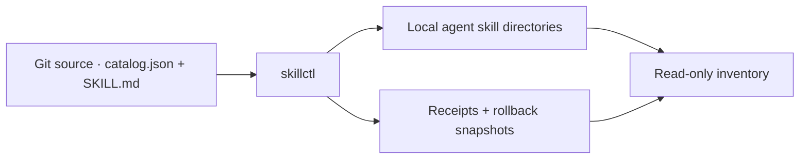

# skillctl

Track and deploy Git-backed Agent Skills with per-file SHA-256 receipts, local edit detection, and rollback. The CLI uses Python 3.9+ and Git.

## Try it

Run the 60-second demo with Python and open the HTML report:

```sh
python demo.py --open
```

The demo installs the same example skill into two temporary directories, edits
the server copy, and attempts another install. The report shows the blocked
update, the changed file, and the two SHA-256 values. The temporary directories
are cleaned up automatically. For another run, use `--output another-demo.html`.

### CLI walkthrough

From this directory, run the commands below with Python. They use a disposable target and state directory inside the checkout.

```sh
python skillctl.py --target .demo/skills --state .demo/state list
python skillctl.py --target .demo/skills --state .demo/state install example-skill
python skillctl.py --target .demo/skills --state .demo/state check
python skillctl.py --target .demo/skills --state .demo/state diff example-skill
python skillctl.py --target .demo/skills --state .demo/state rollback example-skill
```

On Windows, use `python -X utf8` if your console uses a legacy encoding.

## Architecture



A receipt records the Git revision observed at install time and the exact installed file hashes. An identical reinstall retains the original receipt. Before updating or rolling back, the CLI checks the installed files against that receipt and stops on local edits. Each target has separate state. Cross-machine transport and inventory collection are deployment integrations.

## Feedback

Try the demo and open an issue with your agent, OS, and the workflow you wanted to manage. In particular, which would you use first: a project-level lockfile, multi-host inventory, or integration with an existing skill catalog?

## Development

```sh
python -m unittest discover -s tests -v
```
