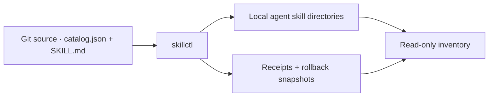

# skillctl

Track and deploy Git-backed Agent Skills with per-file SHA-256 receipts, local edit detection, and rollback. The CLI uses Python 3.9+ and Git.

## Try it

Run the 60-second demo with Python and open the HTML report:

```sh
python demo.py --open
```

The demo installs the same example skill into two temporary directories, edits
the server copy, and attempts another install. The report shows the blocked
update, the changed file, and the two SHA-256 values. The temporary directories
are cleaned up automatically. For another run, use `--output another-demo.html`.

### CLI walkthrough

From this directory, run the commands below with Python. They use a disposable target and state directory inside the checkout.

```sh
python skillctl.py --target .demo/skills --state .demo/state list
python skillctl.py --target .demo/skills --state .demo/state install example-skill
python skillctl.py --target .demo/skills --state .demo/state check
python skillctl.py --target .demo/skills --state .demo/state diff example-skill
python skillctl.py --target .demo/skills --state .demo/state rollback example-skill
```

On Windows, use `python -X utf8` if your console uses a legacy encoding.

## Choose an agent

Select a harness with `--agent`. Project scope defaults to the current working
directory; `--project` selects an existing project explicitly.

| Agent | Project target | User target | Invoke in the agent |
| --- | --- | --- | --- |
| `pi` | `.pi/skills` | `~/.pi/agent/skills` | `/skill:example-skill` |
| `codex` | `.agents/skills` | `~/.agents/skills` | `$example-skill` |
| `claude-code` | `.claude/skills` | `~/.claude/skills` | `/example-skill` |

```sh
python skillctl.py install example-skill --agent pi --scope project --dry-run
python skillctl.py install example-skill --agent pi --scope project
python skillctl.py doctor --agent pi --scope project
python skillctl.py install example-skill --agent codex --scope user
python skillctl.py install example-skill --agent claude-code --project /path/to/project
```

The install response contains the resolved target and invocation examples.
Open a fresh session in the selected project to discover installed skills.
In Pi, `/reload` also refreshes skills in an existing session.
Target options work before or after the subcommand. Keep `--source` and
`--state` before the subcommand.

Existing `--target` commands and their JSON output retain their behavior.
Using neither `--target` nor `--agent` keeps the original
`~/.codex/skills` default. Explicit `--agent codex` follows the current
documented `.agents/skills` locations. Combine `--agent` with `--scope`
or `--project`; use `--target` on its own for custom destinations.
All targets share the same receipt, drift protection and rollback implementation.

Paths and invocation syntax are based on the
[Pi documentation](https://github.com/earendil-works/pi/blob/main/packages/coding-agent/docs/skills.md),
[Codex documentation](https://learn.chatgpt.com/docs/build-skills), and
[Claude Code documentation](https://code.claude.com/docs/en/skills).

## Diagnose an installation

`doctor` reads catalog skills and reports the selected target, installation
status, actionable advice, operation locks, and same-folder-name copies.
It checks standard user locations and project ancestors through the nearest
Git root. Pi also checks shared `.agents/skills`; Codex also checks legacy
`~/.codex/skills`. Each copy includes its per-file hashes; duplicates include
`duplicate_content_equal` and a reminder to review possible shadowing.
Identical resolved locations are inspected once.

Missing skills, drift, unmanaged copies, invalid source files or unreadable
copies produce exit code 1. A source update available is informational.
Duplicate copies are advisory because the agent's settings control precedence.
Global setup errors, such as invalid arguments or an unreadable registry,
produce exit code 2. A healthy report returns 0.

`install --dry-run` previews the resolved target, status, file diff and
blocking conflicts without creating directories, receipts or backups. It
returns 1 if a conflict or operation lock blocks installation.

The diagnostic covers catalog skills in standard locations. Runtime loading,
custom discovery settings, plugins, executable dependencies and model behavior
require separate verification. The CLI integration tests exercise all six
agent/scope combinations in isolated directories, including drift rejection and
rollback. They do not start the agent applications.

## Architecture



A receipt records the Git revision observed at install time and the exact installed file hashes. An identical reinstall retains the original receipt. Before updating or rolling back, the CLI checks the installed files against that receipt and stops on local edits. Each target has separate state. Cross-machine transport and inventory collection are deployment integrations.

## Feedback

Try the demo and open an issue with your agent, OS, and the workflow you wanted to manage. In particular, which would you use first: a project-level lockfile, multi-host inventory, or integration with an existing skill catalog?

## Development

```sh
python -m unittest discover -s tests -v
```
