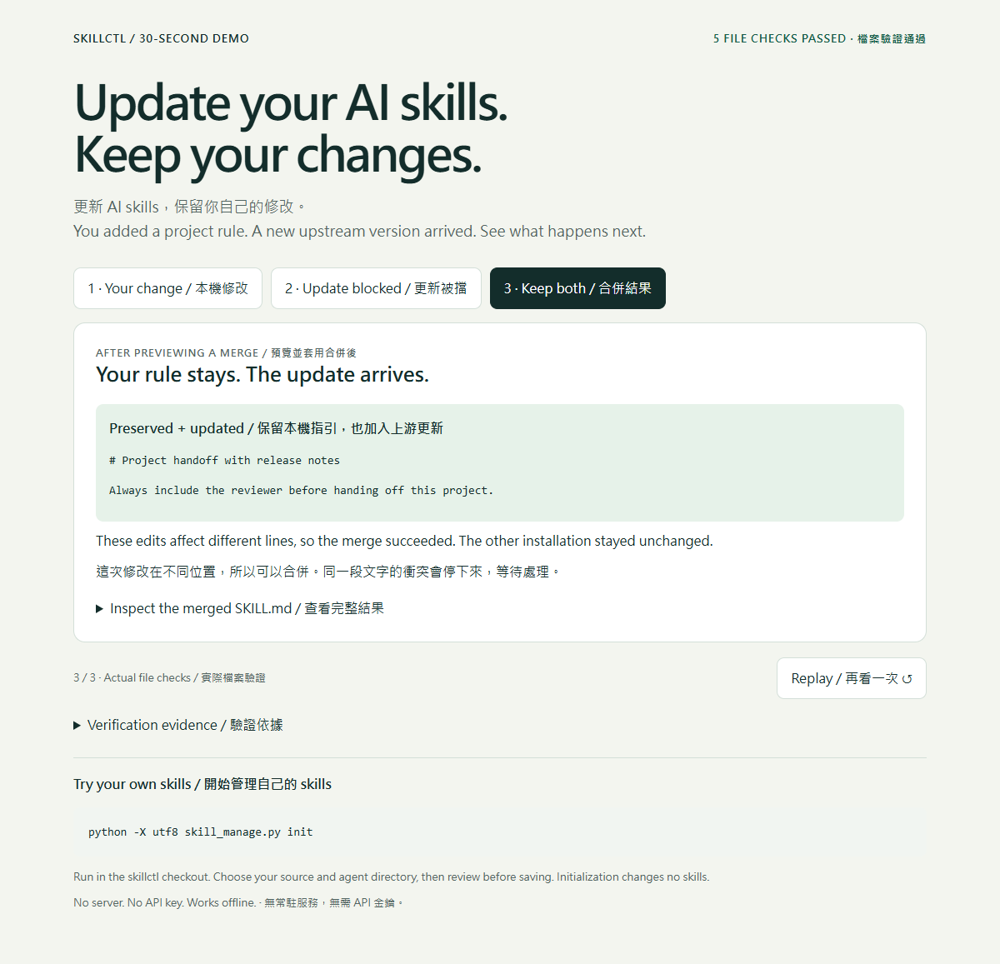

# skillctl

**Update your AI skills. Keep your changes.**

You customize a skill for your project. Its upstream version changes.
skillctl shows what changed, protects your instructions from being overwritten,
and lets you preview a merge or keep your local version.

Works with local skill directories for **Codex, Pi / Orca Pi Chat, Claude Code
and Cursor**. Run it when you need it. No running service or API key is needed
for setup, installation or update management.

[30-second walkthrough](docs/demo.md) · [Full reference](docs/guide.md)

## See it in 30 seconds

Requires **Python 3.10+ and Git**. No Python packages to install.

```sh
git clone https://github.com/anan1999/skillctl.git
cd skillctl
python -X utf8 demo.py --open
```

The demo uses two temporary directories. It never touches your installed skills.

| You do this | skillctl does this |
| --- | --- |
| Add a project rule to a skill | Detects the change in `SKILL.md` |
| Try an upstream update | Blocks replacement and explains which file differs |
| Preview and apply a merge | Keeps your rule and adds the independent upstream change |



The offline report walks through **your change → blocked update → merged result**.
It performs real file operations with example content, then removes the temporary
skill directories. It does not run an AI agent or prove skill behavior.
If a browser doesn't open, open the printed HTML path yourself.
To repeat, choose another filename: `python -X utf8 demo.py --output demo-again.html --open`.

## Set up your own skills

From this checkout:

```sh
python -X utf8 skill_manage.py init
```

The guide asks you to:

1. **Choose a source** — your local upstream skills folder. Press Enter to try the bundled examples.
2. **Choose where your agent reads skills** — existing standard folders appear first; select a project, user or custom location.
3. **Review and save** — see the exact paths before one configuration file is written.

Already used skillctl? Keep the original receipts directory when prompted.
Existing configuration is displayed and left unchanged. Initialization doesn't
install, adopt or update any skills.

Then inspect the configured locations and available skills:

```sh
python -X utf8 skill_manage.py locations
python -X utf8 skill_manage.py list
```

For multiple locations, copy the exact `list --target ...` command printed by
setup. Missing usage or quality reports remain unavailable or untested.

[Setup options, cancellation and existing configurations](docs/initialization.md)

## Ask your agent to manage skills

Using the bundled source and a single configured target, preview installation
of the manager skill:

```sh
python -X utf8 skill_manage.py preview install skillctl-manager
```

Review its destination and changes, then use the returned `plan_id`:

```sh
python -X utf8 skill_manage.py apply YOUR_PLAN_ID
```

With multiple targets, add the **same** `--target "NAME"` to both commands.
If your source is your own skills collection, see the
[manager installation guide](skills/skillctl-manager/references/setup.md).

In a new agent session, ask:

> Read the installed skillctl-manager SKILL.md. Show my skills and explain
> which updates would overwrite local changes. Preview only.

Installation confirms files are present. To confirm your agent loaded the skill,
check its tool history for a successful read of that `SKILL.md`.

## Go further when you need it

### Pin a project's skills and restore them elsewhere

Capture the installed versions, including your local instructions, in one
portable `skillctl.lock.json`. Preview first, then apply the returned plan:

```sh
python -X utf8 skill_manage.py lock create --file /path/to/project/skillctl.lock.json --target "Project"
python -X utf8 skill_manage.py lock apply PLAN_ID --target "Project"
```

On another machine, configure its target, copy the lockfile, and preview a restore:

```sh
python -X utf8 skill_manage.py lock restore --file /path/to/project/skillctl.lock.json --target "Project"
python -X utf8 skill_manage.py lock apply PLAN_ID --target "Project"
python -X utf8 skill_manage.py lock check --file /path/to/project/skillctl.lock.json --target "Project"
```

Snapshots restore offline without the original source path. Destination edits
block the batch; explicit `--keep-local` skips conflicting copies and reports
any remaining differences. Unlisted skills stay untouched. The lockfile includes
full skill content, so review it before sharing. It pins files, not AI behavior
or runtime dependencies.

Try `python -X utf8 lock_demo.py` for a disposable two-machine walkthrough.
[Lockfile guide and limitations](docs/project-lockfile.md)

### Other workflows

| I want to… | Start here |
| --- | --- |
| Bring existing skills under management | [Scan and adopt](docs/guide.md#manage-the-skills-you-already-have) |
| Keep, merge or undo local changes | [Resolve a blocked update](docs/guide.md#understand-and-resolve-a-blocked-update) |
| Choose a harness or diagnose paths | [Targets and doctor](docs/guide.md#choose-an-agent) |
| Use an optional local management page | [Dashboard overview](docs/guide.md#local-management-page) |
| Check 7 / 30-day usage and quality | [Usage and its limits](docs/guide.md#usage-and-quality-together) |
| Record lessons or compare skill versions | [Learning and comparison](docs/guide.md#capture-lessons-and-compare-skill-versions-without-a-server) |

Usage is a lower bound of confirmed Codex `SKILL.md` reads, not successful tasks.
Quality reports are version-bound text checks, not real-world certification.
Conflicting edits need a decision; skillctl doesn't silently resolve them.
[Architecture and full CLI reference](docs/guide.md#architecture)

## Verification and feedback

[Onboarding checks](docs/onboarding-verification.md) ·
[Complex workflow checks](docs/workflow-verification.md) ·
[Earlier Windows / live-agent checks](docs/windows-verification.md)

```sh
python -B -m unittest discover -s tests -v
```

Tried it? [Open an issue](https://github.com/anan1999/skillctl/issues) with your
agent, OS, the step that confused you and what you expected.
Remove private paths, skill content and credentials before sharing.

[MIT license](LICENSE)
