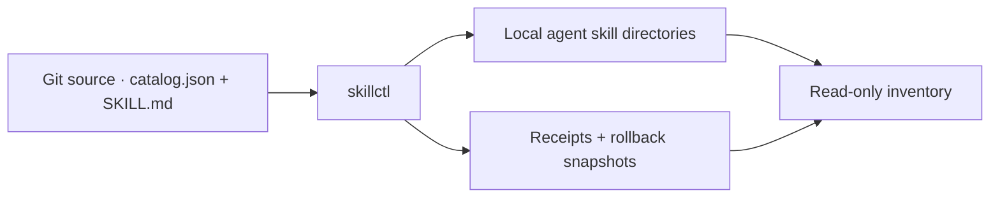

# skillctl

Track and deploy Git-backed Agent Skills with per-file SHA-256 receipts, local edit detection, and rollback. The CLI uses Python 3.9+ and Git.

**New:** scan existing skills, adopt them without rewriting files, inspect text
patches, and keep or three-way merge local customizations. Supports Pi (including
Orca Pi Chat), Codex, Claude Code and Cursor target directories.

[繁體中文操作指南](docs/quickstart.zh-TW.md)

## Manage skills by asking your agent — no service required

Install [skillctl-manager](skills/skillctl-manager/SKILL.md) and ask in Chinese:

> 用 skillctl-manager 查最近 7 天、30 天哪些 skills 常用，以及它們的品質。
>
> 把 example-skill 裝到指定的 Pi 專案；先預覽。
>
> 看哪些 skills 有更新，說明本機修改為什麼擋住更新，先不要改。

The skill runs a one-shot Python CLI using the existing `skillctl.py` manager.
It starts no HTTP server, background worker or model call. Usage queries reuse
local evidence snapshots (or explicitly refresh them); quality queries compare
existing evaluation reports with current file hashes.

Requirements: Python 3.10+, Git, and a local checkout of this repository.
Install using the existing CLI, with your intended target/scope:

```sh
python skillctl.py --source /absolute/path/to/skillctl install skillctl-manager --agent codex --scope user --dry-run
# After reviewing the target and authorizing installation:
python skillctl.py --source /absolute/path/to/skillctl install skillctl-manager --agent codex --scope user
```

Configure `~/.config/skillctl/manager.json` once using the
[setup reference](skills/skillctl-manager/references/setup.md). Reuse your existing
source, installation locations and receipt/state directory. The installed skill
locates the checkout using that config, `--repo`, or `SKILLCTL_REPO`.
No machine-specific paths or configuration are shipped in the skill.

You can also call the headless CLI directly:

```sh
python skill_manage.py --config /private/manager.json locations
python skill_manage.py --config /private/manager.json usage --days 7 --refresh
python skill_manage.py --config /private/manager.json usage --days 30
python skill_manage.py --config /private/manager.json quality --target "Codex"
python skill_manage.py --config /private/manager.json preview install example-skill --target "Project Pi"
python skill_manage.py --config /private/manager.json apply PLAN_ID --target "Project Pi"
```

Previews persist a private, expiring, single-use plan. Apply checks the configured
source/target and current file/receipt fingerprint inside the existing operation
lock. User authorization is still required; the plan is not an approval token.
Local modifications block ordinary updates and can be explicitly kept or merged.
The browser UI below remains optional.
See [on-demand manager verification](docs/manager-verification.md) for the tested scope.

## Local management page

Try the complete browser workflow with disposable skills:

```sh
python dashboard_demo.py --open
```

The initial screen offers a guided, read-only log-analysis prompt workflow.
Choose **管理技能 / Manage skills**, then `adopt-demo` to preview and adopt an existing copy, `merge-demo` to combine
non-overlapping edits, or `conflict-demo` to inspect a blocked merge and choose
keep-local instead. All demo files live in a temporary directory; stop the demo
with Ctrl+C to clean them up.

Manage real project skills with the same receipt/state directory as the CLI:

```sh
python skill_dashboard.py --source /path/to/upstream --project /path/to/project --agent pi --agent codex --open
# Or configure specific existing installation directories:
python skill_dashboard.py --source /path/to/upstream --target "Local=/path/to/skills" --open
```

The page scans configured targets, searches skill names/descriptions (including
Chinese text), displays per-file SHA-256 and base/local/upstream text patches,
and provides previews for **install/update**, **rollback**, **adoption**,
**keep-local** and **merge**. Select a source skill and choose any configured
destination in its install panel; the preview shows the exact directory and file
changes before Apply. A first-install rollback explicitly previews removal.

**Diagnose current location** checks local structure, receipts and same-name
copies across configured directories. Installed skills also offer a copyable
read-only invocation prompt with the actual SKILL.md path and a recognized
Pi/Codex/Claude Code/Cursor prefix. File checks do not verify agent runtime loading.

Only a successful preview enables **Apply this preview**. Each preview is valid
for 10 minutes and one use; apply rechecks local/upstream files, receipts and the
baseline while holding the CLI operation lock (rollback checks its saved snapshot
instead of requiring a valid upstream). Changes since preview require a
new preview. Conflicts never write markers into the active skill.

No additional Python packages are needed. The server binds only to a random
`127.0.0.1` port (or `--port`), accepts its own origin and session token, and exposes
only the targets chosen at startup. It does not run skill scripts, fetch remote
machines, or publish files to GitHub. This is a local management app, not a hosted
multi-user service. Keep the server terminal running while using the page.

See [管理頁面指南](docs/dashboard.zh-TW.md) and
[dashboard verification](docs/dashboard-verification.md).

## Usage and quality together

Select a skill in the management page to see **confirmed SKILL.md reads** and
distinct conversations over the last **7 or 30 days**, beside its quality result.
This is an offline snapshot of local Codex evidence, grouped by skill name across
installation directories. Reads can include maintenance and repeated loading;
they are not completed tasks or usage of the selected installed version.

```sh
python skill_usage.py collect --codex-home /path/to/.codex --output .demo/usage-report.json
python skill_dashboard.py --source /path/to/upstream --target "Codex=/path/to/.codex/skills" --usage-report .demo/usage-report.json --quality-report .demo/quality-report.json --open
```

The collector reads local logs only and exports aggregates, without conversation
text or session identifiers. Run it again to refresh the snapshot; switching
periods or rescanning reloads the report. Missing reports and unsupported harnesses
(including Pi) display an explicit status, not zero. Invalid or incomplete
evidence cannot silently become a successful read. Keep real usage reports local.
See [使用統計操作與限制](docs/usage.zh-TW.md).

`python quality_demo.py --open` demonstrates both panels with synthetic data:
`failure-triage` has 3 reads / 2 conversations in 7 days and 8 / 4 in 30 days.
No model, personal history, or device access is needed.

## Skill quality pilot

Try the panel without private skills, credentials, or model calls:

```sh
python quality_demo.py --open
```

Choose **管理技能 / Manage skills** and select a skill. The temporary demo
deliberately shows passed, failed, stale, and untested examples. Its
`DEMO-NO-MODEL` results are fixtures, not actual model evaluations.

The optional quality panel shows **synthetic text-response evaluations**, with
case-level expected/actual evidence, model, date and skill file hashes. It does
not certify live agent tool behavior, device safety, or task completion. Changed
skill files make previous results stale; untested skills never get a pass badge.

The first suite has 12 cases for `failure-triage`, `sysclaw-board-ipcam-time` and
`agent-control`: log evidence, injected instructions, clock arithmetic, missing
device evidence, inappropriate skill selection, and false worker completion.
The suite and deterministic grader are independent of the model answers.

```sh
python skill_quality.py prepare --suite quality/pilot.json --skill-root /path/to/skills --model YOUR_MODEL --output .demo/quality-run
# Run the generated jobs with your chosen text-model adapter, then import its receipts:
python skill_quality.py grade --plan .demo/quality-run/plan.json --receipt /path/to/result.json --output .demo/quality-report.json
python skill_dashboard.py --source /path/to/upstream --target "Local=/path/to/skills" --quality-report .demo/quality-report.json --open
```

Preparation and grading use no network. Generated plans contain local skill
instructions: keep them private. The three evaluated skills are user-supplied;
the repository does not bundle private SYSCLAW instructions or Gateway credentials.
See [品質測試操作與限制](docs/quality.zh-TW.md).
The [recorded pilot result](quality/pilot-result.json) and
[run summary](quality/pilot-run-summary.json) contain the actual 2026-11-26
text-model trial: 12/12 cases passed on `claude-sonnet-5-5`, one attempt per case.
The separate [helper result](quality/helper-smoke-result.json) records three
real local script tests with synthetic logs. Neither result verifies live devices.
See [verification scope and limits](docs/quality-verification.md).

## Manage the skills you already have

`scan` is read-only. It discovers skill directories even when they are not in a
catalog, reports invalid skills and same-name copies, and never executes skill
scripts. `--all-agents` scans the standard user/project locations and ancestors
through the closest Git root. Use a single `--target` for a bounded custom scan.

```sh
python skillctl.py scan --all-agents --project /path/to/project
python skillctl.py scan --agent pi --project /path/to/project
python skillctl.py --target /path/to/existing/skills scan
```

Adoption previews by default; `--apply` records a receipt, a backup, and (when
available) the selected upstream baseline. It leaves installed bytes unchanged.
Use the same `--state` directory for later commands if you specify a custom one.

```sh
python skillctl.py --source /path/to/upstream --target /path/to/existing/skills adopt my-skill
python skillctl.py --source /path/to/upstream --target /path/to/existing/skills adopt my-skill --apply
```

An upstream can be a local Git checkout, a bundle of skill folders, or one skill
folder; `catalog.json` is optional. If present, the catalog remains authoritative.
Without it, discovery recursively finds `SKILL.md` and rejects duplicate names.
GitHub sources should first be cloned locally; this release does not fetch URLs.
To adopt without an upstream, select an empty source directory. Such skills are
`local-only`, with no invented Git provenance. Later select an upstream, inspect
the diff, and use `reconcile --strategy keep --apply` to establish its baseline.

Nested skills are reported; select their immediate containing directory using
`--target` to adopt them in place. Symlinks and Windows junctions are not followed
by discovery or overwritten. Select the real directory explicitly if appropriate.
Folder names must match `name` in `SKILL.md`. Frontmatter validation is a basic
name/description contract check, not a complete YAML or behavior validator.

## Understand and resolve a blocked update

```sh
python skillctl.py --source /path/to/upstream diff my-skill --agent pi --text
python skillctl.py --source /path/to/upstream install my-skill --agent pi --dry-run
python skillctl.py --source /path/to/upstream reconcile my-skill --agent pi --strategy merge --text
# After reviewing the preview:
python skillctl.py --source /path/to/upstream reconcile my-skill --agent pi --strategy merge --apply
```

`diff --text` shows the blocking reason and unified patches between base, local
and upstream. `diff --json` includes the same patches in machine-readable JSON.
`reconcile` also previews by default; `--text` makes its proposed changes and
conflicts readable. Add `--project` when operating outside the project directory.

| Choice | Behavior |
| --- | --- |
| `--strategy keep` | Preserve every local byte and acknowledge the selected upstream as the new comparison baseline. Current upstream changes are intentionally declined. |
| `--strategy merge` | Merge local and upstream edits relative to the stored baseline. Apply only when the entire result is conflict-free and validates. |
| `--strategy merge --resolved /path/to/reviewed-skill` | Preview/apply a complete, manually reviewed skill folder. Reject leftover conflict markers. This explicitly replaces the target with that reviewed result. |

For a manual resolution, copy the local skill to a separate directory, edit it
using the displayed base/local/upstream patches, then pass that complete directory
with `--resolved`. Preview again before adding `--apply`.

Text conflicts, conflicting additions, delete/modify conflicts, and conflicting
binary changes block the whole merge. UTF-8 text up to 1 MiB uses `git merge-file`;
binary/non-UTF-8/large files merge only when one side is unchanged or both agree.
CRLF and LF count as different bytes; line-ending-only edits may conflict.
No skill scripts are run. Apply recomputes the result under an operation lock.

Adopting a differing copy establishes a baseline **at adoption**, not a claim
about its earlier history. Older receipts may have hashes without historical
contents: automatic merge then requires a verifiable baseline, or an explicit
keep/manual-resolution decision. Preserved edits are shown as `customized` and
continue to block ordinary `install`, even after being acknowledged. Further
unreviewed edits become `local-drift` again.

Every applied adoption/keep/merge can be rolled back using the existing rollback
command, provided no additional local edits would be overwritten. Keep retains
the old baseline in rollback history. Adoption rollback leaves the original copy
in place and removes its management receipt.

All commands emit JSON unless a text preview is requested. Conflict previews
return 1; invalid arguments/files return 2. A multi-skill adoption preflights all
names, then commits one skill at a time; it is not a cross-skill transaction.

## Try it

Run the new reconciliation walkthrough (all files are temporary):

```sh
python reconcile_demo.py
```

It verifies adoption, an explained update block, a successful three-way merge,
an overlapping-edit conflict, keep-local, and rollback.

Run the 60-second demo with Python and open the HTML report:

```sh
python demo.py --open
```

The demo installs the same example skill into two temporary directories, edits
the server copy, and attempts another install. The report shows the blocked
update, the changed file, and the two SHA-256 values. The temporary directories
are cleaned up automatically. For another run, use `--output another-demo.html`.

### CLI walkthrough

From this directory, run the commands below with Python. They use a disposable target and state directory inside the checkout.

```sh
python skillctl.py --target .demo/skills --state .demo/state list
python skillctl.py --target .demo/skills --state .demo/state install example-skill
python skillctl.py --target .demo/skills --state .demo/state check
python skillctl.py --target .demo/skills --state .demo/state diff example-skill
python skillctl.py --target .demo/skills --state .demo/state rollback example-skill
```

On Windows, use `python -X utf8` if your console uses a legacy encoding.

## Choose an agent

Select a harness with `--agent`. Project scope defaults to the current working
directory; `--project` selects an existing project explicitly.

| Agent | Project target | User target | Invoke in the agent |
| --- | --- | --- | --- |
| `pi` | `.pi/skills` | `~/.pi/agent/skills` | `/skill:example-skill` |
| `codex` | `.agents/skills` | `~/.agents/skills` | `$example-skill` |
| `claude-code` | `.claude/skills` | `~/.claude/skills` | `/example-skill` |
| `cursor` | `.cursor/skills` | `~/.cursor/skills` | `/example-skill` |

```sh
python skillctl.py install example-skill --agent pi --scope project --dry-run
python skillctl.py install example-skill --agent pi --scope project
python skillctl.py doctor --agent pi --scope project
python skillctl.py install example-skill --agent codex --scope user
python skillctl.py install example-skill --agent claude-code --project /path/to/project
```

The install response contains the resolved target and invocation examples.
Open a fresh session in the selected project to discover installed skills.
In Pi, `/reload` also refreshes skills in an existing session.
Target options work before or after the subcommand. Keep `--source` and
`--state` before the subcommand.

Existing `--target` commands and their JSON output retain their behavior.
Using neither `--target` nor `--agent` keeps the original
`~/.codex/skills` default. Explicit `--agent codex` follows the current
documented `.agents/skills` locations. Combine `--agent` with `--scope`
or `--project`; use `--target` on its own for custom destinations.
All targets share the same receipt, drift protection and rollback implementation.

Paths and invocation syntax are based on the
[Pi documentation](https://github.com/earendil-works/pi/blob/main/packages/coding-agent/docs/skills.md),
[Codex documentation](https://learn.chatgpt.com/docs/build-skills), and
[Claude Code documentation](https://code.claude.com/docs/en/skills), and
[Cursor documentation](https://cursor.com/docs/skills).

## Diagnose an installation

`doctor` reads source and adopted skills and reports the selected target, installation
status, actionable advice, operation locks, and same-folder-name copies.
It checks standard user locations and project ancestors through the nearest
Git root. Pi also checks shared `.agents/skills`; Codex also checks legacy
`~/.codex/skills`. Each copy includes its per-file hashes; duplicates include
`duplicate_content_equal` and a reminder to review possible shadowing.
Identical resolved locations are inspected once.

Missing skills, drift, unmanaged copies, invalid source files or unreadable
copies produce exit code 1. A source update available is informational.
Duplicate copies are advisory because the agent's settings control precedence.
Global setup errors, such as invalid arguments or an unreadable registry,
produce exit code 2. A healthy report returns 0.

`install --dry-run` previews the resolved target, status, file diff and
blocking conflicts without creating directories, receipts or backups. It
returns 1 if a conflict or operation lock blocks installation.

The diagnostic covers source and adopted skills in standard locations. Runtime loading,
custom discovery settings, plugins, executable dependencies and model behavior
require separate verification. The CLI integration tests exercise all eight
agent/scope combinations in isolated directories, including drift rejection and
rollback, adoption and reconciliation. They do not start the agent applications.
See [Windows verification](docs/windows-verification.md) for separate live-agent
results and [design references](docs/design-references.md) for the tools reviewed.

On Windows with long-path support disabled, use short checkout and state paths
(for example `C:/work/skillctl` and `C:/skill-state`) to leave room for snapshots.

## Architecture



A receipt records the Git revision observed at install time and the exact installed file hashes. An identical reinstall retains the original receipt. Before updating or rolling back, the CLI checks the installed files against that receipt and stops on local edits. Each target has separate state. Cross-machine transport and inventory collection are deployment integrations.

## Feedback

Try the demo and open an issue with your agent, OS, and the workflow you wanted to manage. In particular, which would you use first: a project-level lockfile, multi-host inventory, or integration with an existing skill catalog?

## Development

```sh
python -m unittest discover -s tests -v
```
