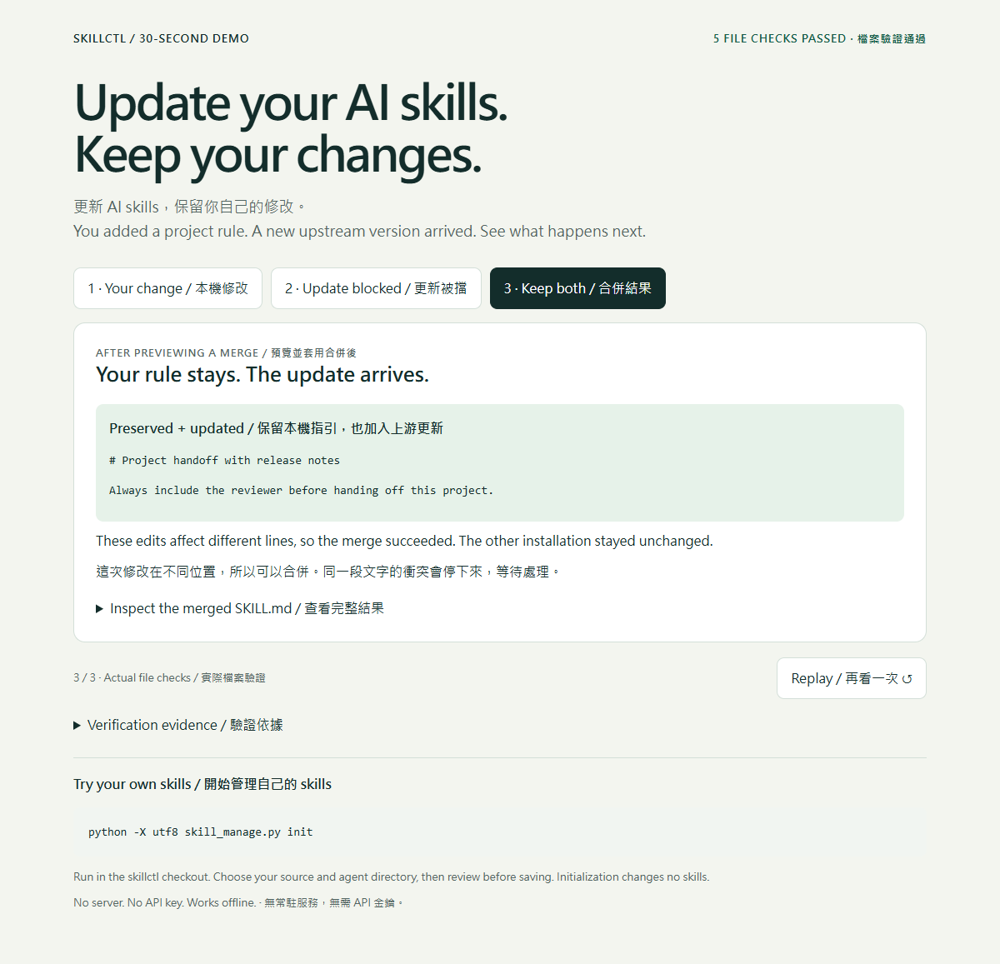

# The 30-second walkthrough

**The problem:** you customize an AI skill, then an upstream update threatens to
replace your project instructions. skillctl lets you see and handle that change.

With Python 3.10+ and Git installed:

```sh
git clone https://github.com/anan1999/skillctl.git
cd skillctl
python -X utf8 demo.py --open
```

No packages, API key, configuration or running web service are needed. The report
is a standalone HTML file and can be refreshed or reopened offline.

| Time | What to look at |
| --- | --- |
| 0–10 s | **Your change:** a local rule requires naming the reviewer; upstream changes the handoff heading. |
| 10–20 s | **Update blocked:** see the actual `SKILL.md` patch and why replacement stops. |
| 20–30 s | **Keep both:** the merge preserves the local rule and includes the upstream change. |

Click **Next**, or any of the three step buttons. The merged file and its hashes
are available in expandable details. With JavaScript disabled, all three steps
remain readable. The 30 seconds describes the walkthrough, not a runtime guarantee.



## What actually ran

The command installs the public `example-skill` into two disposable directories,
edits one copy and the temporary source, attempts an ordinary update, previews a
merge and applies it. It checks five conditions before producing the report:

- Both installations initially match.
- An ordinary update blocks without changing the edited files.
- Merge preview does not write the edited files.
- The applied merge contains both independent changes.
- The other installation stays unchanged.

All example skills and receipts are temporary and removed after execution. The
report remains; it contains synthetic skill content and file hashes. No real
skills, AI agents, devices, API providers or conversation logs are accessed.
This tests file handling, not whether the skill improves an AI response.

If the report filename already exists, choose a fresh output file:

```sh
python -X utf8 demo.py --output demo-again.html --open
```

If a browser cannot open automatically, open the printed file path yourself.
To exercise overlapping conflicts, keep-local and rollback too, run
`python -X utf8 reconcile_demo.py` or see the [complex verification](workflow-verification.md).

Ready to try your own directories? Run `python -X utf8 skill_manage.py init` and
follow the [setup guide](initialization.md).
