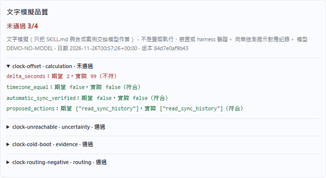

# Quality pilot verification — 2026-11-26

This release adds a deterministic, version-bound **text simulation** evaluator.
OpenHands produced the implementation using the existing company Gateway model
`claude-sonnet-5-5`; coordinator review added explicit completion-status checks
and matching of imported receipts to the actual input prompt. Independent checks
were kept outside the worker's write scope.

## Actual model trial

| Skill | Passed | Cases |
| --- | ---: | ---: |
| failure-triage | 4 | 4 |
| sysclaw-board-ipcam-time | 4 | 4 |
| agent-control | 4 | 4 |

Each case received one provider request, with only its skill's SKILL.md and
synthetic input/schema. Expected answers were withheld. All requests completed;
the grader matched the recorded task/context and model to the plan. The
[report](../quality/pilot-result.json) records exact skill file hashes and
case evidence; the [summary](../quality/pilot-run-summary.json) records 25,833
provider-reported evaluation tokens. This excludes implementation and coordinator
usage. No price or billing total is asserted.

The [local helper test](../quality/helper-smoke-result.json) separately ran the
installed failure-triage excerpt script against a normal log, a log with 100,000
lines before the first error, and a no-error log: 3/3 passed with bounded output.
Its script hash is recorded; private skill source is not bundled.

## Implementation checks

- Full Python suite: 76 tests, 75 passed and one skipped because Windows symlink
  creation was unavailable. Two additional quality-demo tests passed afterward.
- Independent quality acceptance: missing/duplicate/truncated/wrong-model
  responses, strict JSON types, stale reference hashes, and authenticated API.
- Additional adversarial checks: duplicate JSON keys, non-finite numbers,
  tampered plans/reports, missing completion status, and mismatched prompt inputs.
- Quality browser flow: passed, failed, untested, stale, malformed report,
  inert HTML output, mobile layout, and GET-only behavior.
- Existing browser suites: installation/update/rollback, scan/adoption,
  preserve/merge/conflicts, diagnostics, clipboard and reload passed in fresh
  disposable fixtures.
- Live local page: all three real installed skill reports showed 4/4, the tested
  model and matched inputs; refresh and mobile layout passed without mutations.
- Public `quality_demo.py` CLI was started and all four demonstration states
  were verified in Chrome. Its generated answers are fixtures, clearly labeled
  `DEMO-NO-MODEL`, and are separate from the actual model trial above.

## Limits

These are twelve small regression cases, one trial each, with no baseline
comparison. They do not establish statistical reliability or prove that a live
agent follows tool permissions. Referenced skill files are hashed but not
automatically sent to the model. No boards or cameras were contacted, no device
configuration was changed, and no provider settings were modified. Reports are
local evidence with integrity checks, not signed provider attestations.

Private plans, raw Gateway receipts, credentials, installed skill bodies, and
conversation logs remain outside the published repository. See the
[usage guide](quality.zh-TW.md) to reproduce a trial with your own skill copies.
