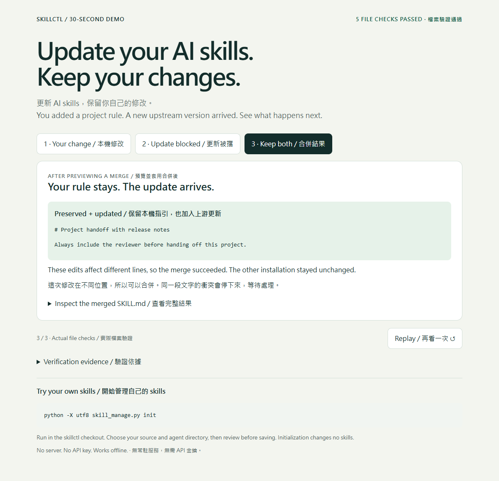

# 更新 AI skills，保留你自己的修改

你替 skill 加了一條專案規則，但上游出了新版。直接複製可能把你的修改蓋掉。
skillctl 幫你看差異、擋下覆蓋，再讓你選擇保留或合併。

如果你已經有一些會自行修改的 skills，或在不同專案、不同 agent 之間使用，
這就是它要幫忙解決的問題。管理時才執行，不需要常駐服務。

## 先花 30 秒看懂

準備 **Python 3.10+ 和 Git**。不用額外裝 Python 套件，也不用 API 金鑰。

在終端機依序執行：

```sh
git clone https://github.com/anan1999/skillctl.git
cd skillctl
python -X utf8 demo.py --open
```

已有 checkout 就從該目錄執行最後一行。畫面有三步，按「下一步」即可：

1. **本機修改**：你加了一條「交接時註明審閱者」的規則。
2. **更新被擋**：上游也有更新，畫面顯示哪個檔案不同、為什麼不能直接覆蓋。
3. **合併結果**：本機規則保留下來，上游新內容也加入了。



這會在兩個暫存目錄實際驗證安裝、阻擋與合併，完成後清除暫存 skills。
不會碰你已安裝的 skills、不會操作板子或呼叫模型。
HTML 報告留在 checkout，重新整理或離線重開都能看。
若瀏覽器沒自動開啟，打開終端機印出的 HTML 路徑即可。

再次執行請換一個輸出名稱：

```sh
python -X utf8 demo.py --output demo-again.html --open
```

## 設定要管理哪裡

在同一個 checkout 執行：

```sh
python -X utf8 skill_manage.py init
```

引導會依序詢問：

| 問題 | 怎麼選 |
| --- | --- |
| Source / 來源 | 上游 skills 的本機資料夾；剛開始試用可按 Enter，用內附範例。 |
| Project / 專案 | 填你要管理的專案路徑；預設是目前目錄，不一定是你的工作專案。 |
| 管理位置 | 列表會把已存在的目錄排前面。選編號；多個用逗號分隔；0 可填自訂目錄。 |
| State / 收據 | 原本用過 skillctl，請沿用原收據目錄，才能保留納管與還原歷史。 |
| Save / 儲存 | 看完來源、目標、收據位置後，輸入 y 才儲存。直接 Enter 就取消。 |

初始化只建立 `~/.config/skillctl/manager.json`。
不會自動安裝、接管或更新 skills，已經有設定就顯示並保留原樣。
目錄存在只代表找得到檔案，不代表 agent 已載入。

完成後，複製引導印出的查詢命令。只有一個管理位置時也可執行：

```sh
python -X utf8 skill_manage.py locations
python -X utf8 skill_manage.py list
```

有多個位置時，使用引導給你的 `list --target "名稱"` 命令。
`missing` 是來源有、目標尚未安裝；`unmanaged-*` 是目標已有、尚未接管。
先確認位置正確，再決定要管理哪些 skills。

需要自訂設定檔或由 agent 代跑？看 [初始化選項](initialization.md)。

## 讓 AI 用中文幫你管理

如果初始化時用了內附來源，先預覽 manager skill 的安裝：

```sh
python -X utf8 skill_manage.py preview install skillctl-manager
```

看清楚安裝目標與差異，把回傳的 `plan_id` 放入下一行，才會真正安裝：

```sh
python -X utf8 skill_manage.py apply YOUR_PLAN_ID
```

若有多個位置，兩行都加同一個 `--target "名稱"`。
若選了自己的 skills 來源，依 [manager 安裝說明](../skills/skillctl-manager/references/setup.md)
使用 checkout 的 manager 套件，並沿用目前目標與收據。

在新聊天中可直接說：

> 請讀取已安裝的 skillctl-manager 的 SKILL.md，看看有哪些 skills、哪些有更新，
> 哪些更新會影響我的修改。先不要套用。

之後也可以說：

> 用 skillctl-manager 查最近 7 天與 30 天哪些 skills 常用，品質如何；沒測過的請明講。

檔案安裝成功不等於 agent 已載入。要確認真的使用過，請檢查工具紀錄中成功讀取
`SKILL.md` 的證據。未設定使用報告、尚未測試的品質會明確顯示，不會當成 0 次或通過。

## 下一步按需要選

- [把現有 skills 接管、看差異、保留或合併、還原](reconcile.zh-TW.md)
- [使用次數和品質的意義與限制](usage.zh-TW.md)
- [選用的網頁管理介面](dashboard.zh-TW.md)
- [完整命令與架構](guide.md)
- [這次新手流程的驗證範圍](onboarding-verification.md)

遇到不清楚的地方，可以到 [GitHub issues](https://github.com/anan1999/skillctl/issues)
說明用哪個 agent、作業系統與卡在哪一步。分享前移除私人路徑、技能內容與金鑰。
